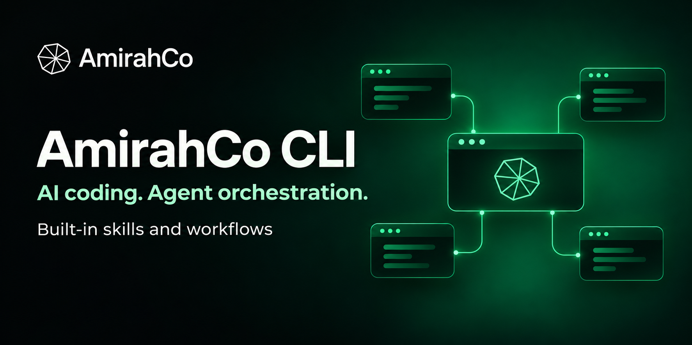

# AmirahCo CLI



An AI coding CLI centered on agent orchestration: plan a project, carry its context into coding, coordinate agents and check results from your terminal. Based on [OpenClaude](https://github.com/Gitlawb/openclaude), with an emerald interface and bundled project-planning and code-quality skills.

**Release status:** Windows prototype. Bring your own supported provider API key. Optional partner-backed evaluation access is limited and manually approved. This repository is a release candidate; no unlimited credits or guaranteed hands-free completion are offered.

[Get started](#windows) · [Tester guide](docs/TESTER-GUIDE.md) · [Capabilities](docs/CAPABILITIES.md) · [Report a bug](https://github.com/soin8293/AmirahCo-CLI/issues/new/choose) · [License scope](LICENSE-SCOPE.md)

## Windows

Download the reviewed Windows x64 installer from this repository's release assets when the release is published. Verify its SHA-256 against the accompanying checksums. It installs per user, creates Desktop and Start-menu shortcuts and bundles its native dependencies; WSL is not required. The current installer is unsigned, so Windows may show a trust warning.

Open AmirahCo CLI and configure your provider using its native setup. You may start a chat, create a project or reopen existing work. Never paste keys into project files, issues, screenshots or shared chats. Your provider's quota, terms and billing apply.

## What's included

- Native startup menus, scrolling/history, agent tabs, session history and saved intake/PRD review.
- Six project skills for context, discovery, clarification, PRD drafting, scoped work and review.
- Three coding-quality skills adapted from Ponytail, P-Stack and the thermonuclear review, plus /simplify. Invocation uses the native Skill tool and current permissions.
- A packaged Foundry lifecycle component for reviewed project work and evidence. See [capability status](docs/CAPABILITIES.md) for the implementation and qualification boundaries.
- A native update picker with Install/Later and next-safe-launch recovery. The hosted update channel is not active in this candidate.

## Source setup

Use the qualified native Node.js 24.22.1 and Bun 1.4.4 with the checked-in lockfile:

```sh
bun install --frozen-lockfile
bun run build
node bin/amirahcocli
```

For an explicitly selected OpenAI-compatible provider, use a private environment file based on .env.example and pass --provider-env-file. The CLI deliberately does not auto-load project .env files. Set only your provider's values. Source workflow execution additionally needs native Python 3.11+ with sqlite3; the Windows installer bundles its qualified runtime.

Experimental native teams use the supported --agent-teams opt-in or CLAUDE_CODE_EXPERIMENTAL_AGENT_TEAMS=1. Team orchestration must respect the selected total, current permission mode, Stop, context and budgets. Native team primitives do not establish fully unattended, restart-safe completion of every project.

## Optional partner test access

The public app works with your own supported key. If you want to participate in the Heabsy/Inferbase evaluation pilot, message the maintainer for instructions. Sign-in at [tester access](https://www.amirahco.us/ai/tester-access) is separate from access approval. Pending accounts receive no key. Approval has explicit expiry, usage limits and revocation; replacement never replenishes quota. Availability depends on the approved pilot capacity.

Powered by [Heabsy](https://heabsy.com). Inferbase participates in the limited evaluation pilot. This does not promise a free personal provider account or indefinite credits.

## Development and security

See [public PRD](docs/PRD.md), [security policy](SECURITY.md), [capability status](docs/CAPABILITIES.md), [Windows build](packaging/windows/README.md) and [license scope](LICENSE-SCOPE.md). Existing state and unfinished work must be preserved during fixes and upgrades. Public issues must not include credentials, private conversations or customer files.

## License and attribution

[LICENSE](LICENSE) preserves the inherited notices. [LICENSE-AMIRAHCO](LICENSE-AMIRAHCO) covers AmirahCo-owned original additions only; it does not relicense third-party or inherited code. See [license scope](LICENSE-SCOPE.md). The open-source publication disposition remains subject to those component boundaries.
