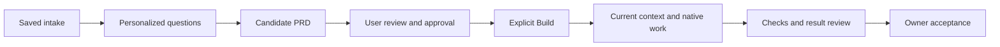

# Workflows and built-in skills

The app combines guided project planning, saved context and native coding tools. The skills give the agent instructions for a task; they do not start a separate service or grant tool permissions.

## Project flow



Approval and Build are separate actions. Build hands current approved context to the native work path. The packaged Foundry component coordinates eligible workflow steps and evidence; it does not independently prove that an application is complete. See [capability limits](CAPABILITIES.md).

New chat skips guided project intake. It still uses the normal provider, tools and permission controls. A chat does not become an approved project merely because a planning skill is requested.

## Select a skill

Run `/skills` in the CLI to inspect available skills. You can ask for one by its exact name and describe the scope, for example:

> Use amirahco-code-quality to review the reading-list changes. Preserve the current behavior and report findings before editing.

The native Skill tool is the invocation boundary. Automatic matching can recommend a skill, but a prompt mentioning a skill is not proof it was loaded. Check the visible tool activity when testing invocation.

## Bundled project skills

| Native name | Purpose |
|---|---|
| `amirahco-context` | Retrieve current decisions, restrictions, sources and omissions for the task |
| `amirahco-discovery` | Turn the idea and existing material into a bounded discovery packet |
| `amirahco-clarify` | Ask consequential missing questions without repeating answered ones |
| `amirahco-prd` | Create, update or validate requirements and acceptance criteria |
| `amirahco-work` | Execute eligible work within approved scope, context and limits |
| `amirahco-review` | Compare artifacts and actual checks with the current requirements |

## Bundled quality skills

| Native name | Adapted guidance | Purpose |
|---|---|---|
| `amirahco-code-quality` | Ponytail and selected P-Stack guidance | Reuse existing code and make the smallest complete, verified change |
| `amirahco-typescript-quality` | P-Stack TypeScript and boundary guidance | Review schemas, types, narrowing and external-input boundaries |
| `amirahco-maintainability-review` | Thermonuclear review and Ponytail questions | Inspect ownership, duplication, coupling, branching and maintenance risks |

These are packaged adaptations, not installations of every upstream plugin, command or lifecycle hook. Original notices and resource mappings remain with the [quality pack](../src/skills/bundled/amirahcoQualityResources.json). You do not need to install the upstream repos to use these bundled entries.

## Use /simplify

For a review without edits:

```text
/simplify Review the current reading-list diff only. Report findings; do not edit.
```

For explicitly authorized cleanup:

```text
/simplify Simplify the current reading-list diff. Preserve behavior, keep unrelated work untouched and run the relevant checks.
```

The command stays in the current native session and loads the quality guidance through the Skill tool. TypeScript work also uses the TypeScript skill. It consolidates findings instead of creating hidden reviewers. With no identifiable change scope, it asks for one.

Review-only work stays read-only. Authorized cleanup still respects permissions, Stop, current requirements and writable scope. The command does not enable an automatic repair loop or turn self-review into independent or owner acceptance.

## Agents and interruptions

The selected total includes the lead. One agent uses the current session; larger totals use native teammates and their in-app tabs. Native teams are experimental and opt-in in this release. Exact selected-team completion, rollover and high-pressure recovery still need broader qualification.

Agents use current project records and context, not an assumption that every earlier chat is remembered. On missing context, Stop, exhausted access or uncertain delivery, keep the current work and inspect the reason before resuming. See [recovery](private-prototype-recovery.md) for the developer contracts and [troubleshooting](TROUBLESHOOTING.md) for user steps.

Source definitions: [core skills](../src/skills/bundled/amirahcoCore.ts), [quality skills](../src/skills/bundled/amirahcoQuality.ts), [/simplify](../src/skills/bundled/simplify.ts).
